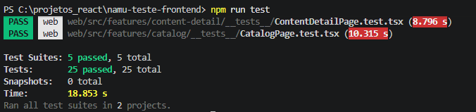

# Namu · Conteúdos de bem-estar

Teste técnico de Front-end da Namu: biblioteca de conteúdos de bem-estar com catálogo, detalhe e favoritos.

Monorepo com a versão web, o app mobile e um pacote compartilhado entre os dois. O mobile ainda está em desenvolvimento.

## Tecnologias

- TypeScript
- React 19 + Vite
- React Router
- TanStack Query
- Axios
- Material UI + Tailwind CSS
- ESLint + Prettier
- React Native (mobile)

## Funcionalidades (web)

- Catálogo paginado com busca por título e filtro por categoria
- Detalhe do conteúdo em `/conteudos/:id`
- Favoritar e desfavoritar com atualização otimista
- Estados de carregamento, vazio e erro
- Layout responsivo e navegação por teclado

## Como rodar

Requer Node 22.11+.

Suba a API a partir do [repositório do teste](https://github.com/sioux1to1/teste-frontend-react-react-native-namu):

```bash
cp .env.example .env
docker compose up -d
```

Depois, na raiz deste projeto:

```bash
npm install
cp web/.env.example web/.env
npm run dev:web
```

A web abre em `http://localhost:5173` e usa a API em `http://localhost:3333` (configurável em `VITE_API_URL`).

## Scripts

```bash
npm run dev:web      # desenvolvimento
npm run build:web    # build de produção
npm run typecheck    # checagem de tipos
npm run lint         # ESLint
npm run format       # Prettier
npm test             # testes (shared + web)
```

## Testes

Jest + React Testing Library, com a API mockada. Cobrem os fluxos principais:

- **Catálogo**: listagem, busca, filtro por categoria, estado vazio (inclusive categoria sem conteúdo), placeholder para conteúdo sem imagem, descarte de respostas antigas da busca, erro com "tentar novamente" e navegação para o detalhe
- **Detalhe**: exibição, favoritar/desfavoritar, rollback com erro ao favoritar, 409 de favorito duplicado, clique duplo rápido, erro 500 com "tentar novamente", placeholder sem imagem, 404 e id inválido
- **Teclado**: link "Pular para o conteúdo" e fluxo completo (buscar, abrir detalhe e favoritar) sem mouse
- **Shared**: formatações (incluindo durações extremas como 45 s e 1 h 2 min), mensagens de erro e política de retry



O CI ([.github/workflows/ci.yml](.github/workflows/ci.yml)) roda lint, formatação, tipos e testes a cada push na `main` e em pull requests.

## Estrutura

```
packages/shared   tipos, cliente da API e formatações
web               aplicação React
mobile            app React Native
```

## Pendências

- App mobile
