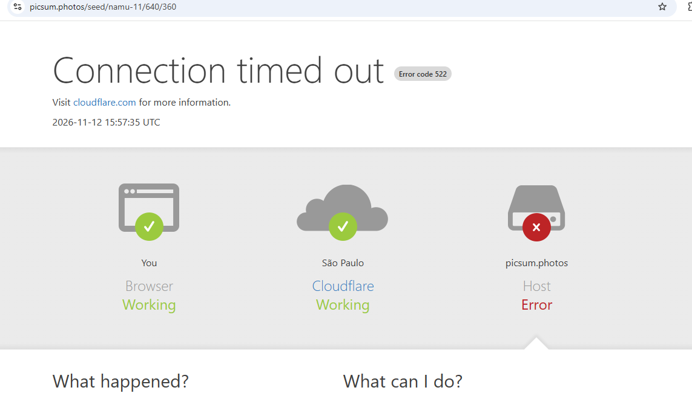

# Namu · Mobile

App React Native da biblioteca de conteúdos de bem-estar da Namu. Usa os tipos, o cliente da API e as formatações do pacote [`@namu/shared`](../packages/shared).

## Tecnologias

- TypeScript
- React Native 0.88
- React Navigation (native stack)
- TanStack Query
- Axios

## Funcionalidades

- Listagem de conteúdos com scroll infinito e pull-to-refresh
- Detalhe do conteúdo com favoritar e desfavoritar
- Tela de favoritos
- Estados de carregamento e erro
- Placeholder "Imagem não disponível" para conteúdo sem imagem ou com imagem que falhou

## Como rodar

Antes, siga o guia [Set Up Your Environment](https://reactnative.dev/docs/set-up-your-environment) do React Native e suba a API (veja o [README da raiz](../README.md#api)).

O mobile tem as próprias dependências. Dentro de `mobile/`:

```bash
npm install
npm start
```

Com o Metro rodando, em outro terminal:

```bash
npm run android:device   # Android (emulador ou aparelho via USB)
npm run ios              # iOS
```

O app acessa a API em `http://localhost:3333` ([src/config/env.ts](src/config/env.ts)). No Android, o `android:device` faz o `adb reverse` das portas 8081 (Metro) e 3333 (API), para que `localhost` no aparelho aponte para a sua máquina.

No iOS, instale os pods na primeira vez e sempre que mudar alguma dependência nativa:

```bash
bundle install
bundle exec pod install
```

## Imagens que não carregam

O mobile também tem conteúdos que aparecem com o placeholder "Imagem não disponível" mesmo tendo imagem cadastrada. O motivo é o mesmo da web: as `thumbnailUrl` devolvidas pela API apontam para o [picsum.photos](https://picsum.photos), que está instável e responde com **erro 522 (Connection timed out)** do Cloudflare. Quando o `Image` do React Native não consegue carregar a imagem, o `ContentThumbnail` mostra o placeholder no lugar dela. Não é um problema do app.



Os testes feitos e o motivo de não ter retentativa automática estão no [README da web](../web/README.md#imagens-que-não-carregam).
