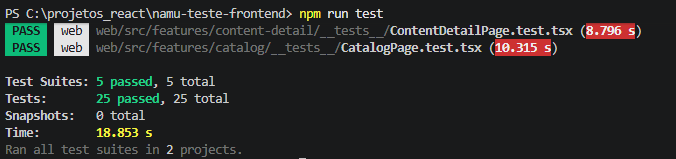
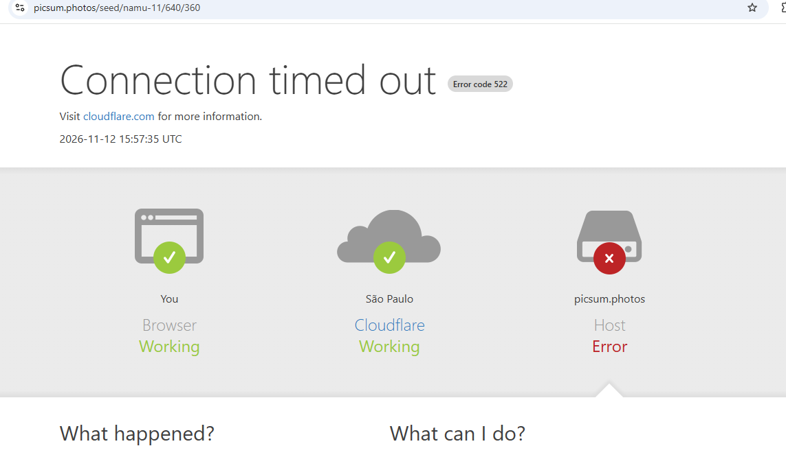

# Namu · Web

A versão web da biblioteca de conteúdos, feita com React 19, Vite, TypeScript, React Router, TanStack Query, Material UI e Tailwind.

## O que tem

- Catálogo paginado com busca por título e filtro por categoria
- Página de detalhe, com favoritar e desfavoritar
- Telas de carregamento, lista vazia e erro
- Layout responsivo e navegação pelo teclado

## Versão online

**https://namu-teste-frontend-web.vercel.app**

> **A API precisa estar rodando na sua máquina.** Só o front está publicado, e ele busca os dados em `http://localhost:3333`. Sem a API, a página abre, mas mostra erro. Veja [como subir a API](../README.md#api).

No Chrome e no Edge, pode aparecer um pedido para o site acessar a rede local. É só clicar em **Permitir**. O Safari bloqueia essa chamada, então nele é melhor rodar localmente.

Se algo não funcionar, é só me chamar que eu ajudo.

## Como rodar

Com a API no ar, na raiz do projeto:

```bash
npm install
cp web/.env.example web/.env
npm run dev:web
```

Abre em `http://localhost:5173`. Para usar outro endereço de API, troque o `VITE_API_URL` no `.env`.

## Testes

Rode `npm test` na raiz. Os testes usam Jest e React Testing Library, com a API mockada, e cobrem o catálogo, o detalhe, os favoritos (inclusive quando a API falha) e o uso só pelo teclado.



## Imagens que não carregam

Alguns cards podem mostrar "Imagem não disponível" mesmo tendo imagem. Não é bug do front: as imagens vêm do [picsum.photos](https://picsum.photos), que está fora do ar e responde com erro 522.



Quando a imagem falha, o app mostra o placeholder no lugar. Cheguei a testar tentar de novo automaticamente, mas cada tentativa levava uns 20 segundos para falhar e o card ficava em branco por quase um minuto, então desisti. O ideal é a API usar outra fonte de imagens.
